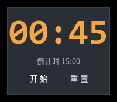
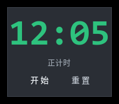
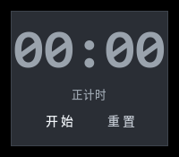

<div align="center">

# 🕐 Floating Timer

**A translucent, always-on-top countdown / stopwatch widget for your desktop**

Pure **Python + Tkinter**, zero third-party dependencies. Perfect for
presentations, meetings, and time-boxed talks — keep an eye on the clock
without leaving your screen corner.

[](LICENSE)
[](#)
[](https://github.com/Liu-Project/floating-timer/actions/workflows/ci.yml)
[](https://github.com/Liu-Project/floating-timer/releases)
[](https://github.com/Liu-Project/floating-timer)

[Features](#-features) · [Screenshots](#-screenshots) · [Install](#-install) ·
[Usage](#-usage) · [Build](#-build) · [中文说明](#中文说明)

</div>

---

## ✨ Features

- **Always on top & draggable** — floats over every window, drag it anywhere.
- **Two modes** — count-up stopwatch (how long have I been talking?) and
  count-down timer (my 15 minutes are almost up).
- **Visual reminders** — the clock flashes red every full minute, and blinks
  when the countdown finishes.
- **Keyboard shortcuts** — `Space` to start/pause, `R` to reset, double-click
  the time to toggle.
- **Right-click menu** — switch mode, nudge the duration ±1 min, toggle
  always-on-top, or quit.
- **Frosted-glass look** — translucent with desktop compositor blur (KDE),
  gracefully falling back to plain translucency on other desktops.
- **No dependencies** — standard library only; runs anywhere Python + Tkinter
  are available.

## 📸 Screenshots

| Countdown (last minute) | Stopwatch (running) | Idle |
|:---:|:---:|:---:|
|  |  |  |

> 💡 Want to see more states? Run it yourself — it only takes one command:

## 📦 Install

### Option 1 — run from source (any platform)

```bash
# Linux/macOS
python3 src/floating_timer.py

# Windows
py src/floating_timer.py
```

> **Note (Linux):** Tkinter may need a system package, e.g. `sudo apt install python3-tk`.

### Option 2 — pip install

```bash
pip install .
floating-timer
```

### Option 3 — pre-built binary / RPM

Grab the latest release from the
[Releases page](https://github.com/Liu-Project/floating-timer/releases):

- `floating_timer` — a self-contained static binary (PyInstaller one-file),
  copy it to any EL8 x86_64 machine and run.
- `floating-timer-*.rpm` — install with:

```bash
sudo dnf install ./floating-timer-*.rpm
```

## 🎮 Usage

| Action | How |
|---|---|
| Start / pause | `Space`, click **开始**, or double-click the time |
| Reset | `R` or click **重置** |
| Switch mode | Right-click → *切换：倒计时/正计时* |
| Adjust duration | Right-click → *时长 ±1 分* |
| Drag | Left-drag anywhere on the card |
| Always on top | Right-click → *置顶* |
| Quit | Right-click → *退出* |

## 🛠 Build

Build the static binary and the RPM package in one go:

```bash
./build.sh
```

Requirements: Python 3.12, `rpmbuild` (`rpm-build` package), network access
(to fetch PyInstaller).

| Artifact | Description |
|---|---|
| `dist/floating_timer` | Self-contained static binary |
| `rpm/RPMS/x86_64/floating-timer-*.rpm` | RPM package for EL8-compatible machines |

## 🗺 Roadmap

- [x] Count-up / count-down modes
- [x] Minute flash + finish alert
- [x] Translucency & frosted glass
- [ ] Cross-platform packaging (Windows/macOS)
- [ ] Configurable colors & fonts
- [ ] Preset durations
- [ ] Sound alert on finish

## 🤝 Contributing

Contributions are welcome! Please read [CONTRIBUTING.md](CONTRIBUTING.md) first.
See [CHANGELOG.md](CHANGELOG.md) for release history.

## 📄 License

[MIT](LICENSE) © Liu-Project

---

## 中文说明

**悬浮计时器** — 毛玻璃风格的悬浮置顶倒计时 / 正计时小工具，适合汇报、会议时放在屏幕角落查看用时。纯 Python + Tkinter 实现，无第三方依赖。

- **功能**：始终置顶悬浮、可拖拽；正计时/倒计时两种模式；整分钟数字变红提醒、倒计时结束红色闪烁；快捷键 `空格` 开始/暂停、`R` 重置；右键菜单管理。
- **直接运行**：`python3 src/floating_timer.py`
- **一键构建**：`./build.sh` 产出静态二进制与 RPM 安装包。
- 毛玻璃的"背景模糊"依赖桌面合成器（KDE 桌面效果 → 模糊），未开启时自动降级为半透明。
